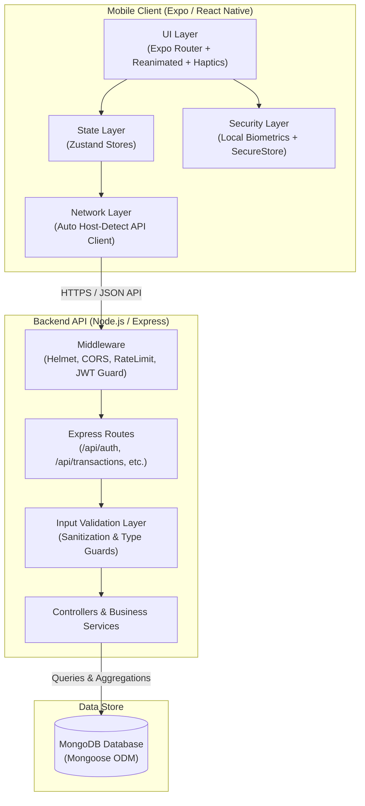

# 💎 Pocksy

<p align="center">
  
</p>

<p align="center">
  <strong>Know Your Money. Own Your Spending.</strong><br>
  <em>The modern, privacy-first personal finance and wealth management platform for iOS, Android & Web.</em>
</p>

<p align="center">
  <a href="#-tech-stack"></a>
  <a href="#-tech-stack"></a>
  <a href="#-tech-stack"></a>
  <a href="#-tech-stack"></a>
  <a href="#-tech-stack"></a>
  <a href="#-tech-stack"></a>
</p>

<p align="center">
  
  
  
  
  
</p>

---

## 📑 Table of Contents

- [Overview](#-overview)
- [System Architecture](#-system-architecture)
- [Key Features](#-key-features)
- [Tech Stack](#-tech-stack)
- [Project Structure](#-project-structure)
- [REST API Reference](#-rest-api-reference)
- [Database Schema Models](#-database-schema-models)
- [Getting Started](#-getting-started)
  - [Prerequisites](#prerequisites)
  - [1. Clone Repository](#1-clone-repository)
  - [2. Backend Setup & Configuration](#2-backend-setup--configuration)
  - [3. Mobile Setup & Launch](#3-mobile-setup--launch)
- [Network & Device Troubleshooting](#-network--device-troubleshooting)
- [Environment Variables](#-environment-variables)
- [NPM Scripts Reference](#-npm-scripts-reference)
- [Security & Architecture Practices](#-security--architecture-practices)
- [Development Roadmap](#-development-roadmap)
- [Contributing](#-contributing)
- [License](#-license)

---

## 🌟 Overview

**Pocksy** is an all-in-one financial operating system designed to give users total visibility and control over their financial health. Built with performance and tactile ergonomics in mind, Pocksy combines a responsive, glassmorphic React Native client with a high-throughput Express / MongoDB backend.

Whether logging everyday expenses, analyzing multi-month cashflow velocity, tracking loan payables/receivables, or setting progressive savings goals, Pocksy delivers bank-grade privacy without the clutter.

---

## 🏗️ System Architecture



---

## ✨ Key Features

### 📊 Real-Time Financial Dashboard
- **Net Worth Aggregator**: Automatically sums balances across all linked cash wallets, bank accounts, credit cards, and investments.
- **Cashflow Speedometer**: Live income vs. expense comparison for the active billing cycle.
- **Quick-Action Dial**: One-tap access to record transactions, transfer funds, or schedule recurring payments.

### 💸 Multi-Modal Transaction Engine
- **Transaction Types**: Full support for **Expenses**, **Income**, and **Inter-Account Transfers**.
- **Contextual Categorization**: Tagging, payment method selection, custom merchant notes, and date overrides.
- **Filter & Search**: Instant full-text search with multi-parameter filtering (by date range, account, category, or type).

### 📈 Visual Analytics & Insights
- **Category Spending Breakdowns**: Visual distribution of where your capital flows each month.
- **Historical Cashflow Trends**: Compare current period expenditure against prior months.
- **Export Capabilities**: Export transaction ledgers for accounting and record-keeping.

### 🎯 Savings Goals & Milestones
- **Target Tracking**: Set targets with custom target completion dates and milestone increments.
- **Deposit Ledgers**: Log progressive savings deposits linked directly to funding accounts.
- **Progress Visualizers**: Dynamic progress bars and projected completion timelines.

### 💳 Debt & Loan Ledgers (IOU / UOM)
- **Dual Direction**: Track money you owe (**Payable**) versus money owed to you (**Receivable**).
- **Settlement Tracking**: Support for partial payments, remaining balance calculation, and due date alerts.
- **Counterparty Contact Info**: Keep borrower/lender details attached directly to the debt record.

### 🔄 Subscriptions & Recurring Bills
- **Cadence Rules**: Support for Daily, Weekly, Bi-Weekly, Monthly, and Annual recurring cycles.
- **Upcoming Due Calendar**: Avoid overdrafts and missed subscription renewals.
- **Auto-Processor Engine**: Backend hooks ready to process due items automatically into transactions.

### 🛡️ Privacy & Biometric Gateway
- **Biometric Lock**: Protect app access with Face ID, Touch ID, or Android Biometric Prompt.
- **Encrypted Local Cache**: Auth tokens and sensitive sessions stored securely in hardware-backed `Expo SecureStore`.
- **Stateless JWT**: Standardized Bearer token authentication with bcrypt password encryption on the server.

---

## 🛠️ Tech Stack

### Mobile Frontend
| Technology | Purpose |
| :--- | :--- |
| **React Native 0.86** | Cross-platform native mobile foundation |
| **Expo SDK 57** | Universal developer tooling and native module access |
| **Expo Router** | File-based typed routing with deeply integrated transitions |
| **TypeScript** | End-to-end static type safety |
| **Zustand** | Lightweight, reactive state management |
| **React Hook Form + Zod** | Declarative form handling and runtime schema validation |
| **React Native Reanimated** | Fluid 60fps gesture-driven animations |
| **Expo Haptics & Glass Effect** | Tactile vibration feedback and modern UI aesthetics |
| **Expo SecureStore & Local Auth** | Hardware-backed keychain storage and biometric security |

### Backend API
| Technology | Purpose |
| :--- | :--- |
| **Node.js (v18+)** | High-performance asynchronous JavaScript runtime |
| **Express.js (v4.21)** | RESTful API server framework |
| **TypeScript** | Structured server code with strict type contracts |
| **MongoDB & Mongoose (v8.8)** | Document database with schema modeling and index optimization |
| **JWT & bcryptjs** | Token-based authentication and secure password hashing |
| **Helmet & Rate Limiter** | HTTP header hardening and brute-force mitigation |
| **Morgan & CORS** | Structured request logging and Cross-Origin Resource Sharing |

---

## 📁 Project Structure

```text
pocksy/
├── backend/
│   ├── src/
│   │   ├── config/              # Database connections & environment configs
│   │   ├── controllers/         # Business logic handlers for all API routes
│   │   │   ├── accountController.ts
│   │   │   ├── authController.ts
│   │   │   ├── budgetController.ts
│   │   │   ├── dashboardController.ts
│   │   │   ├── debtController.ts
│   │   │   ├── goalController.ts
│   │   │   ├── recurringController.ts
│   │   │   └── transactionController.ts
│   │   ├── middleware/          # JWT auth guard, error handling, rate limiting
│   │   ├── models/              # Mongoose data schemas (User, Transaction, etc.)
│   │   ├── routes/              # Express endpoint routing definitions
│   │   ├── services/            # Reusable business service layer
│   │   ├── types/               # TypeScript interfaces & custom express declarations
│   │   ├── utils/               # Formatting, response helpers & math utilities
│   │   ├── validators/          # Request payload validation rules
│   │   ├── app.ts               # Express application pipeline setup
│   │   └── server.ts            # Server bootstrap and cluster listener
│   ├── .env.example             # Template for backend environment variables
│   ├── package.json
│   └── tsconfig.json
│
├── mobile/
│   ├── assets/                  # App icons, splash screens, custom font definitions
│   ├── src/
│   │   ├── app/                 # Expo Router file-based route hierarchy
│   │   │   ├── (auth)/          # Authentication flow (Login, Register, Recovery)
│   │   │   ├── (onboarding)/    # First-launch onboarding walkthrough
│   │   │   ├── (tabs)/          # Core navigation tabs
│   │   │   │   ├── index.tsx        # 🏠 Dashboard & Balance Overview
│   │   │   │   ├── transactions.tsx # 📜 Transaction History & Filtering
│   │   │   │   ├── add.tsx          # ➕ Quick Add Transaction Modal
│   │   │   │   ├── analytics.tsx    # 📊 Spending Charts & Insights
│   │   │   │   └── profile.tsx      # ⚙️ Settings, Accounts, Goals, Biometrics
│   │   │   └── _layout.tsx      # Global provider wraps (Auth, Theme, Modals)
│   │   ├── components/          # Reusable UI component library & cards
│   │   ├── constants/           # Design tokens, color palettes, currency schemas
│   │   ├── hooks/               # Custom lifecycle & utility hooks
│   │   ├── services/            # HTTP API Client & endpoint service modules
│   │   ├── store/               # Zustand global state slices
│   │   │   ├── authStore.ts
│   │   │   ├── accountStore.ts
│   │   │   ├── transactionStore.ts
│   │   │   └── dashboardStore.ts
│   │   └── types/               # Frontend TypeScript domain types
│   ├── app.json                 # Expo project manifest & native permissions
│   ├── package.json
│   └── tsconfig.json
│
└── README.md
```

---

## 🔌 REST API Reference

All routes are mounted under the `/api` prefix. Protected routes require an `Authorization: Bearer <token>` header.

### 🔐 Authentication (`/api/auth`)
| Method | Endpoint | Auth Required | Description |
| :--- | :--- | :---: | :--- |
| `POST` | `/api/auth/register` | ❌ No | Create a new user profile |
| `POST` | `/api/auth/login` | ❌ No | Authenticate user & return JWT token |
| `GET` | `/api/auth/me` | ✅ Yes | Fetch active user credentials and preferences |
| `PUT` | `/api/auth/updatedetails` | ✅ Yes | Update profile name, currency, and preferences |
| `PUT` | `/api/auth/updatepassword` | ✅ Yes | Change user password |
| `POST` | `/api/auth/refresh` | ✅ Yes | Refresh current session token |
| `POST` | `/api/auth/logout` | ✅ Yes | Revoke session |

### 📊 Dashboard (`/api/dashboard`)
| Method | Endpoint | Auth Required | Description |
| :--- | :--- | :---: | :--- |
| `GET` | `/api/dashboard` | ✅ Yes | Fetch net worth, recent activity, and monthly totals |

### 💸 Transactions (`/api/transactions`)
| Method | Endpoint | Auth Required | Description |
| :--- | :--- | :---: | :--- |
| `POST` | `/api/transactions` | ✅ Yes | Record an expense, income, or transfer |
| `GET` | `/api/transactions` | ✅ Yes | Retrieve paginated transactions with filters |
| `GET` | `/api/transactions/export` | ✅ Yes | Export transaction history |
| `GET` | `/api/transactions/:id` | ✅ Yes | Get transaction detail by ID |
| `PUT` | `/api/transactions/:id` | ✅ Yes | Modify an existing transaction |
| `DELETE`| `/api/transactions/:id` | ✅ Yes | Delete a transaction & adjust balance |

### 🏦 Accounts & Wallets (`/api/accounts`)
| Method | Endpoint | Auth Required | Description |
| :--- | :--- | :---: | :--- |
| `POST` | `/api/accounts` | ✅ Yes | Create a new account (Bank, Cash, Card, Investment) |
| `GET` | `/api/accounts` | ✅ Yes | List all user accounts with calculated balances |
| `GET` | `/api/accounts/:id` | ✅ Yes | Fetch single account details |
| `PUT` | `/api/accounts/:id` | ✅ Yes | Update account name, color, or icon |
| `DELETE`| `/api/accounts/:id` | ✅ Yes | Delete account |
| `POST` | `/api/accounts/transfer` | ✅ Yes | Perform atomic inter-account funds transfer |

### 🎯 Savings Goals (`/api/goals`)
| Method | Endpoint | Auth Required | Description |
| :--- | :--- | :---: | :--- |
| `POST` | `/api/goals` | ✅ Yes | Create a new financial target |
| `GET` | `/api/goals` | ✅ Yes | List all goals with progress percentages |
| `GET` | `/api/goals/:id` | ✅ Yes | Fetch goal details |
| `PUT` | `/api/goals/:id` | ✅ Yes | Modify target amount or deadline |
| `DELETE`| `/api/goals/:id` | ✅ Yes | Delete savings goal |
| `POST` | `/api/goals/:id/savings` | ✅ Yes | Deposit money toward a goal |

### 💳 Debts & Loans (`/api/debts`)
| Method | Endpoint | Auth Required | Description |
| :--- | :--- | :---: | :--- |
| `POST` | `/api/debts` | ✅ Yes | Create a payable or receivable debt entry |
| `GET` | `/api/debts` | ✅ Yes | List all active/settled debts |
| `GET` | `/api/debts/:id` | ✅ Yes | Fetch single debt entry |
| `PUT` | `/api/debts/:id` | ✅ Yes | Update debt terms |
| `DELETE`| `/api/debts/:id` | ✅ Yes | Remove debt record |
| `POST` | `/api/debts/:id/payment` | ✅ Yes | Record a partial or full debt payment |

### 🔄 Recurring & Subscriptions (`/api/recurring`)
| Method | Endpoint | Auth Required | Description |
| :--- | :--- | :---: | :--- |
| `POST` | `/api/recurring` | ✅ Yes | Create recurring subscription / bill rule |
| `GET` | `/api/recurring` | ✅ Yes | List all recurring transactions |
| `GET` | `/api/recurring/:id` | ✅ Yes | Get recurring rule details |
| `PUT` | `/api/recurring/:id` | ✅ Yes | Update cadence, amount, or category |
| `DELETE`| `/api/recurring/:id` | ✅ Yes | Delete recurring schedule |
| `POST` | `/api/recurring/process` | ✅ Yes | Trigger evaluation of due recurring transactions |

### 🩺 Health (`/api/health`)
| Method | Endpoint | Auth Required | Description |
| :--- | :--- | :---: | :--- |
| `GET` | `/api/health` | ❌ No | Server uptime and database connectivity probe |

---

## 🗄️ Database Schema Models

```text
User ───────────────────┐
├── name, email, pass   │ 1:N
├── currency, biometrics│ ───► Account (Bank, Cash, Card, Investment)
└── createdAt           │ ───► Transaction (Income, Expense, Transfer)
                        │ ───► Budget (Category, Monthly Limit)
                        │ ───► Goal (Target Amount, Current Saved)
                        │ ───► Debt (Payable, Receivable, Due Date)
                        └───► RecurringTransaction (Cadence, Next Run)
```

- **`User`**: Account identity, security configuration, and preferred default currency.
- **`Account`**: Represents liquid or credit containers with distinct balances and styling tokens.
- **`Transaction`**: Immutable record of money movement referencing User, Account, Category, and Timestamp.
- **`Budget`**: Category spending threshold per calendar month with alert boundaries.
- **`Goal`**: Targeted savings reserve with target amount, completion deadline, and deposit ledger.
- **`Debt`**: Bilateral lending/borrowing agreement with counterparty details and payment history.
- **`RecurringTransaction`**: Rule-based template that calculates next due dates across billing cadences.

---

## 🚀 Getting Started

### Prerequisites

Ensure you have the following installed on your machine:
- **Node.js**: `v18.0.0` or higher ([Download](https://nodejs.org/))
- **npm** (comes with Node) or **yarn** / **pnpm**
- **MongoDB**: Local MongoDB instance (`mongod`) or free cluster on [MongoDB Atlas](https://www.mongodb.com/atlas)
- **Expo Go App**: Install on your physical device from App Store / Google Play (optional for physical device testing)

---

### 1. Clone Repository

```bash
git clone https://github.com/Aaryan-9784/Pocksy.git
cd Pocksy
```

---

### 2. Backend Setup & Configuration

1. Navigate to the `backend` folder:
   ```bash
   cd backend
   ```

2. Install backend dependencies:
   ```bash
   npm install
   ```

3. Create your `.env` configuration file:
   ```bash
   cp .env.example .env
   ```

4. Populate your `.env` parameters:
   ```env
   PORT=5000
   NODE_ENV=development
   MONGODB_URI=mongodb://localhost:27017/pocksy
   JWT_SECRET=your_super_secret_jwt_key_here
   JWT_EXPIRE=30d
   ```

5. Launch the API in development mode:
   ```bash
   npm run dev
   ```
   > You should see: `✅ MongoDB connected` and `🚀 Pocksy API running on port 5000`.

---

### 3. Mobile Setup & Launch

1. Open a new terminal window and navigate to the `mobile` folder:
   ```bash
   cd mobile
   ```

2. Install mobile dependencies:
   ```bash
   npm install
   ```

3. Start the Expo development server:
   ```bash
   npx expo start
   ```

4. Choose your preferred runtime:
   - **Physical Device**: Scan the QR code displayed in the terminal using the **Expo Go** app (Android) or **Camera App** (iOS).
   - **Android Emulator**: Press **`a`** (requires Android Studio).
   - **iOS Simulator**: Press **`i`** (macOS + Xcode required).
   - **Web Browser**: Press **`w`**.

---

## 📶 Network & Device Troubleshooting

Pocksy's mobile client includes an **intelligent automatic API URL resolver** in [`src/services/api.ts`](mobile/src/services/api.ts):
- **Web**: Routes to `http://localhost:5000/api`
- **Android Emulator**: Routes to `http://10.0.2.2:5000/api`
- **iOS Simulator**: Routes to `http://localhost:5000/api`
- **Expo Go on Physical Phone**: Automatically detects your computer's local Wi-Fi IP address from the Expo debugger host.

> [!TIP]
> **Connecting Physical Phone via Expo Go**: Ensure both your development computer and your smartphone are connected to the **same local Wi-Fi network**, and that port `5000` is allowed through your firewall.

---

## ⚙️ Environment Variables

### Backend Configuration (`backend/.env`)

| Variable | Type | Required | Default | Purpose |
| :--- | :--- | :---: | :--- | :--- |
| `PORT` | `number` | No | `5000` | Port on which the Express server listens |
| `NODE_ENV` | `string` | No | `development` | Environment mode (`development` / `production`) |
| `MONGODB_URI`| `string` | **Yes**| `mongodb://localhost:27017/pocksy` | MongoDB connection URI string |
| `JWT_SECRET` | `string` | **Yes**| — | Cryptographic secret used for signing JWTs |
| `JWT_EXPIRE` | `string` | No | `30d` | Lifetime duration for user access tokens |

---

## 📜 NPM Scripts Reference

### Backend Scripts (`/backend`)
```bash
npm run dev     # Starts backend with nodemon + ts-node for instant hot-reload
npm run build   # Compiles all TypeScript files into production JavaScript in /dist
npm start       # Launches compiled production server from /dist/server.js
```

### Mobile Scripts (`/mobile`)
```bash
npx expo start      # Starts Expo Metro bundler
npm run android     # Starts and connects directly to Android emulator
npm run ios         # Starts and connects directly to iOS simulator
npm run web         # Starts web development build
npm run lint        # Runs ESLint analysis across mobile codebase
```

---

## 🔒 Security & Architecture Practices

- **Zero Plaintext Passwords**: Passwords are salted and hashed via `bcryptjs` before storage.
- **Hardware-Level Security**: Tokens are stored using `expo-secure-store` (iOS Keychain / Android KeyStore).
- **HTTP Header Hardening**: Secure HTTP response headers applied via `helmet`.
- **Brute Force Protection**: Endpoint rate limiting configured on sensitive routes via `express-rate-limit`.
- **Strict Input Validation**: All incoming requests validated before reaching the service layer.

---

## 🗺️ Development Roadmap

- [x] **Phase 1: Project Architecture & Theme Tokens**
- [x] **Phase 2: JWT Authentication & Biometric Local Auth**
- [x] **Phase 3: Core Transaction CRUD (Income, Expense, Transfer)**
- [x] **Phase 4: Multi-Account & Wallet System**
- [x] **Phase 5: Financial Dashboard & Net Worth Calculations**
- [x] **Phase 6: Monthly Budget Limits & Threshold Warnings**
- [x] **Phase 7: Financial Goals & Piggy Bank Savings**
- [x] **Phase 8: Debt & Loan Tracking (Payables & Receivables)**
- [x] **Phase 9: Recurring Subscriptions & Cadence Management**
- [x] **Phase 10: Visual Analytics & Breakdown Charts**
- [ ] **Phase 11: Receipt Scanning with Smart OCR**
- [ ] **Phase 12: AI-Powered Spending Insights & Anomalies**
- [ ] **Phase 13: Multi-Currency Live Conversion & Cloud Backups**

---

## 🤝 Contributing

Contributions make the open-source community an incredible place to learn, inspire, and create. Any contributions you make are **greatly appreciated**.

1. Fork the Project
2. Create your Feature Branch (`git checkout -b feature/AmazingFeature`)
3. Commit your Changes (`git commit -m 'Add some AmazingFeature'`)
4. Push to the Branch (`git push origin feature/AmazingFeature`)
5. Open a Pull Request

---

## 📄 License

Distributed under the **MIT License**. See [`LICENSE`](LICENSE) for more information.

<p align="center">
  Built with ❤️ for financial freedom.
</p>
